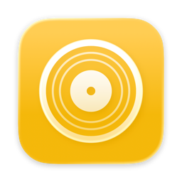
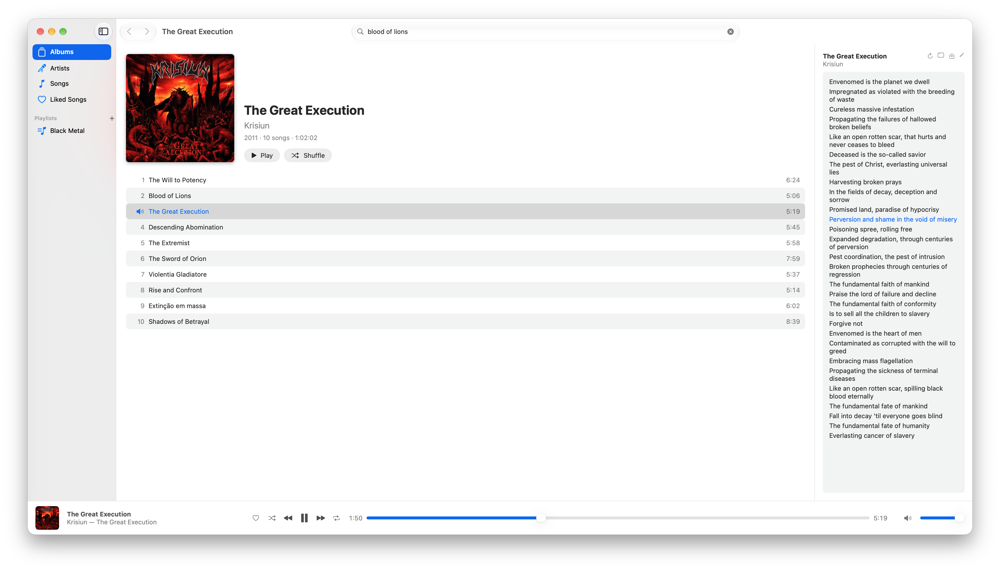

<p align="center"></p>

# Overdrive

[](https://github.com/skhaz/overdrive/releases/latest)

A music player for the Mac (macOS 26 or later). It plays the music that is already on your Mac. You do not have to import anything.



## Features

- **Uses your music folders.** Add a folder and your albums show at once. New songs that you put in the folder show automatically.
- **Plays all common formats:** AAC, ALAC, MP3, FLAC, Opus, Vorbis, WAV, and AIFF.
- **Album covers** from your music files or from the image in the album folder.
- **Lyrics** that move with the song. If a song has no lyrics, the app finds them on the internet. You can also type and save your own, and show them in a small window that stays on top.
- **Same volume for all songs**, so you do not have to change the volume between songs.
- **Last.fm:** keeps a list of the songs that you listen to in your Last.fm profile.
- **Music videos from YouTube** in a small window that stays on top.
- **Discovery:** pick 1, 10, 20, or 100 songs at random from your library and play them right away.
- **Playlists** and **Up Next** (the list of what plays next). Up Next in the sidebar shows the song that plays and the songs that come after it. Add songs to it from the menu of a song; they go to the end of the list. Drag them to change the order, or press Delete to remove them. Click the trash button to clear the list. After you confirm, the song stops and the player starts again with no song.
- **Liked songs.** Like any song and find them all in **Liked Songs** in the sidebar.
- **Continues where you stopped.** When you open the app again, it shows the same song, at the same time.
- **Keyboard media keys** and Control Center play, pause, and change songs.
- **Apple Music does not open by accident** while you use Overdrive.
- **Song details:** the quality and the size of each song file.
- **Mp3tag:** if you have Mp3tag, you can open your songs in it to edit their names and details.

## Install

Install [Homebrew](https://brew.sh), open Terminal, and type:

```sh
brew install --cask skhaz/tap/overdrive
```

## How to use

### Add your music

Drag a music folder to the window, or choose Overdrive > Settings > Folders > Add Folder. You can add more than one folder. The app also finds the songs in the folders inside it.

### Find and play

- Use the sidebar to see **Albums**, **Artists**, or **Songs**.
- Type in the search field to find an artist, an album, or a song. The search stays until you clear it with Escape, Command-K, or the clear button.
- To go back to the previous screen, click the back arrow at the top, press Command-[, or swipe to the right on the trackpad. To go forward again, click the forward arrow, press Command-], or swipe to the left. The side buttons of a mouse also work.
- Double-click a song to play it. On an album, click **Play** or **Shuffle**.
- Click a column title (Title, Artist, Album, Time) to sort a list. Click again to reverse the order, and a third time to go back to the order of the list. When you leave a list or quit the app, the list goes back to its own order.
- Albums go from the oldest to the newest.
- Use the bar at the bottom to play, pause, go to the previous or next song, shuffle, repeat, go to a different part of the song, and change the volume.
- Click the cover or the name in the bottom bar to open the album that plays.

The song that plays shows in color and is selected in the list.

### Discover songs

Choose **Controls > Discovery** and pick 1, 10, 20, or 100 songs. The app picks that many songs at random from your whole library, puts them in Up Next, and plays the first one. What was in Up Next before goes away.

A value that needs more songs than your library has is dimmed. The pick never follows the search: it reads the whole library.

### Use the menu of a song

Right-click a song, an album, or the bottom bar. You can:

- **Add to Up Next** (the songs go to the end of the list).
- **Add to Playlist**.
- **Watch Video on YouTube**.
- **Go to Album** or **Go to Artist**.
- **Copy** the song name, the artist, the album, or "Artist - Song Name".
- See the **Information** of the song file. Click an item to copy it.
- **Open in Mp3tag** or **Show in Finder**.

To do this for more than one song, select the songs with Command-click or Shift-click, then right-click one of them.

### Make playlists

1. Click **+** in the sidebar, or choose File > New Playlist.
2. Right-click songs or albums and choose **Add to Playlist**.
3. Drag the songs in the playlist to change the order.
4. To remove a song, right-click it and choose **Remove from Playlist**, or press Delete.

To delete a playlist, right-click it in the sidebar. The playlists live in a Playlists folder inside your music folder, with a backup copy, so they move with your music.

### Like songs

Click the heart in the bottom bar to like the song that plays. You can also right-click any song or album and choose **Like Song**. A heart shows next to each liked song in the lists.

Click **Liked Songs** in the sidebar, below Songs, to see all liked songs. To remove a like, right-click the song and choose **Unlike Song**, or click the heart again while the song plays.

### Lyrics

The lyrics show at the right side when a song plays. Click a line to go to that part of the song. To change the lyrics, click **Edit** (Command-E) and type. The app saves the lyrics next to the song by itself. To remove the lyrics, delete all the text. The lyrics that the app finds on the internet stay next to the song, in a file with the `.cache.lyrics` extension, for one month. After that the app looks for them again and keeps the old ones if it finds nothing new. To keep the lyrics that the app finds on the internet, edit them.

To hide the lyrics, click the lyrics button in the toolbar (Option-Command-Y). Click it again to show them. While the lyrics are hidden, the app does not look for them. The app remembers your choice.

Click the undock button at the top of the lyrics to move them to a small window that floats above all other windows. The window shows the album cover, the song, the artist, and the album. It also has the play controls: previous, play or pause, next, and a slider for the position of the song. You can edit the lyrics in the window too. Drag the window to move it. It keeps the lyrics when the next song plays. Click the X in the window to put the lyrics back in the app.

To float the lyrics of the song that plays at any time, choose Controls > Show Lyrics in a Floating Window (Command-U). It works for every song, even when the song has no lyrics.

### Watch the music video

1. Right-click a song and choose **Watch Video on YouTube**.
2. The first time, sign in to your Google account in the window. Passkeys do not work in this window, so click **Try another way** and use your phone, or your password and a code.
3. The video plays in a small window in a corner of the screen. The song in Overdrive pauses.

Drag the window to move it to a different corner. Put the pointer on the video to see the close button. When you play a song in Overdrive, the video window closes.

### Connect Last.fm

Choose Overdrive > Settings > Last.fm. Type your Last.fm username (not the email) and password, and click **Connect**.

### Settings

| Setting | What it does |
| --- | --- |
| Folders | The folders with your music. |
| Playback > Show Spectrum | Show or hide the bars of the song that plays, above the playback controls (default: shown). |
| Last.fm | Connect or disconnect your Last.fm account. |
| YouTube > Open Videos In | Show the videos in the small window (default) or in your web browser. |
| YouTube > Window Corner | The corner of the screen for the video window. |
| YouTube > Sign Out | Sign out of YouTube. |

To turn off the same volume for all songs, choose Controls > Normalize Volume.

### Keyboard shortcuts

The Song menu at the top of the screen has the same actions as the right-click menu, for the selected songs or album. The menus show the shortcut of each action that has one.

| Keys | Action |
| --- | --- |
| Up Arrow, Down Arrow | Go to the previous or next item |
| Shift-Up Arrow, Shift-Down Arrow | Add the previous or next song to the selection |
| Left Arrow, Right Arrow | Go to the previous or next album (when the search field is empty) |
| Return | Open the album or the artist, or play the song. If the song plays, pause it |
| Space | Play or pause (when the search field is empty) |
| Escape | Close the video. Stop to edit the lyrics. Clear the search. Go back |
| Delete | Remove the selected songs from the playlist, or delete the selected playlist in the side bar |
| Tab | Go between the side bar and the main area |
| Command-[ | Go back to the previous screen |
| Command-] | Go forward again |
| Control-Return | Open the menu of the item, as with a right-click |
| Command-Return | Add the selected songs to the end of Up Next |
| Shift-Command-L | Like or unlike the selected songs |
| Shift-Command-Y | Watch the video of the selected song on YouTube |
| Shift-Command-N | New playlist with the selected songs |
| Shift-Command-R | Show the selected songs in Finder |
| Command-Delete | Remove the selected songs from the playlist |
| Command-Right Arrow | Next song |
| Command-Left Arrow | Previous song |
| Option-Command-Right Arrow | Go forward 10 seconds |
| Option-Command-Left Arrow | Go back 10 seconds |
| Command-Up Arrow | Increase the volume |
| Command-Down Arrow | Decrease the volume |
| Command-L | Show the album of the song that plays |
| Option-Command-L | Like or unlike the song that plays |
| Option-Command-S | Shuffle on or off |
| Option-Command-R | Repeat: off, all songs, or one song |
| Command-E | Edit the lyrics |
| Option-Space | From any app: open Overdrive and search |
| Command-U | Show the lyrics in a floating window |
| Option-Command-Y | Show or hide the lyrics |
| Command-N | New playlist |
| Command-R | Look for new music in your folders |
| Command-K | Clear the search |
| Command-, | Settings |
| Media keys | Previous song, play or pause, next song |

## Good to know

- Click **About** at the top of the sidebar to see the version of the app and to open its page on GitHub, report a problem, or see the releases. The page also checks GitHub for a new version and shows a link when there is one. If GitHub does not answer, the page shows nothing more.

- The app never changes your songs. It only saves the lyrics that you save.
- Your liked songs, playlists, and lyrics live with your music. Back up your music folder and you back up all of them.
- The app keeps a file named `Cache.sqlite` in each music folder. With it, the app opens faster. You can delete it at any time: the app makes it again. The app checks your music folders by itself when they change and every 10 minutes. To check them at once, choose File > Sync Library (Command-R). If you change the tags of a song with an app that keeps the file date, choose File > Rebuild Library Cache: the app reads all your songs again. Until it finishes, you see the library as it was.
- When you play an album in order, the quiet and loud songs of the album stay as the artist made them.
- No Last.fm play is lost. If there is no internet, the app sends them later.
- The video window opens at once, and you stay signed in to YouTube.
- YouTube can show an ad. With YouTube Premium, there are no ads.
- If something goes wrong, the app keeps a log of the last day in `~/Library/Logs/Overdrive`. Send it with your bug report.

## Credits

- App icon: “[iPod Orange](https://macosicons.com/icon/ipod-orange-siHDxmuV8f)” by p_bluealt, from macOSicons. The MIT license does not apply to the icon.
- Lyrics: [LRCLIB](https://lrclib.net) and [lyrics.ovh](https://lyrics.ovh).
- Scrobbles: [Last.fm](https://www.last.fm).
- Music videos: [YouTube](https://www.youtube.com).
- GitHub mark on the About page: [Primer Octicons](https://github.com/primer/octicons) (MIT). GitHub and the GitHub logo are trademarks of GitHub, Inc.

The About page in the app shows the same credits, with the same links.
